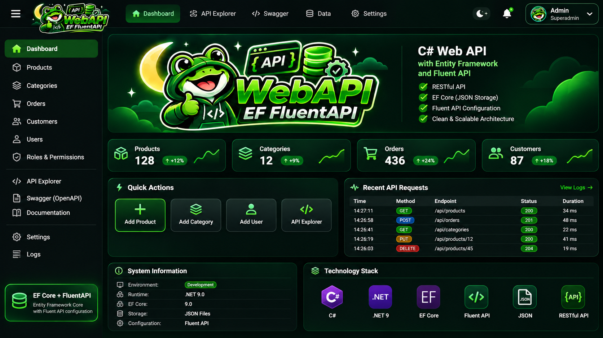

# 🐸 WebAPI EF FluentAPI

<div align="center">


**🌙 Dark mode · 💚 Forest green · ⚡ ASP.NET Core · 🗃️ JSON storage**

[](https://dotnet.microsoft.com/)
[](https://learn.microsoft.com/dotnet/csharp/)
[](https://learn.microsoft.com/ef/core/modeling/)
[](https://swagger.io/)

</div>

## ✨ Overview

A dark-green ASP.NET Core 8 REST API starter with a smiling frog and crescent-moon visual identity. The application uses one shared **SVG** logo in the site header, home hero, monitor wallboard and favicon.

The logo and dashboard preview below are the PNG assets uploaded to this repository. The dashboard image is a **design mockup**, not a verified screenshot of the running application.

## 🖥️ Dashboard preview



*Dark-mode dashboard design concept featuring the frog identity, navigation, API panels, and green accents. Some pictured functionality is illustrative and is not implemented in this starter.*

## 🧰 Technology stack

| Icon | Technology | Role |
|---|---|---|
| 💻 | C# / .NET 8 | Application runtime |
| 🌐 | ASP.NET Core | Minimal REST API |
| 🧩 | Entity Framework Core InMemory | EF model demonstration |
| 🛠️ | Fluent API | Entity configuration via `IEntityTypeConfiguration<T>` |
| 🗂️ | JSON files | Actual persistence, separate from EF Core |
| 📖 | Swagger / OpenAPI | Interactive API documentation |
| 🌚 | HTML / CSS / JavaScript | Responsive dark-green dashboard |

**Important:** EF Core is used for model configuration and its in-memory provider; it does **not** persist the JSON data. The JSON store is implemented independently.

## 🚀 Quick start

```bash
git clone https://github.com/1x4x/20-webapi-ef-fluentapi.git
cd 20-webapi-ef-fluentapi
dotnet restore
dotnet run
```

Open the local address printed by `dotnet run`. Visit `/swagger` to explore the API.

## 🧭 API endpoints

| Method | Endpoint | Description |
|---|---|---|
| 🟢 GET | `/api/health` | Health and storage details |
| 🟢 GET | `/api/boards` | List boards |
| 🟢 GET | `/api/boards/{id}` | Get one board |
| 🔵 POST | `/api/boards` | Create board |
| 🟠 PUT | `/api/boards/{id}` | Replace board |
| 🔴 DELETE | `/api/boards/{id}` | Delete board |


## 📅 Swedish namedays API

The API includes **628 nameday records** from the supplied Swedish list. Seed data lives in `Data/namedays.seed.json`; the first modification creates `App_Data/namedays.json`. Subsequent reads and writes use that editable JSON file. The EF Core Fluent API mapping models the entity but does not persist the JSON.

| Method | Route | Action |
|---|---|---|
| 🟢 GET | `/api/namedays` | List all namedays |
| 🔎 GET | `/api/namedays?search=ann` | Search by name |
| 🟢 GET | `/api/namedays/name/Valter` | Look up an exact name |
| 📅 GET | `/api/namedays/date/8/17` | All names on 17 August |
| ☀️ GET | `/api/namedays/today` | Names for server-local current date |
| 🔵 POST | `/api/namedays` | Create a nameday |
| 🟠 PUT | `/api/namedays/name/Valter` | Update a nameday |
| 🔴 DELETE | `/api/namedays/name/Valter` | Delete a nameday |

Example response for `GET /api/namedays/name/Valter`:

```json
{
  "name": "Valter",
  "day": 17,
  "month": 8
}
```

Create a nameday:

```bash
curl -X POST http://localhost:5000/api/namedays -H "Content-Type: application/json" -d '{"name":"Example","day":15,"month":6}'
```

The date route uses `month/day` order, including February 29 validation. `/today` uses the server's local clock. CRUD routes are currently unauthenticated, as in the existing starter API; add authentication before exposing them publicly.

## 🎨 Branding

- 🐸 Smiling frog mascot
- 🌙 Glowing crescent moon
- 💚 Dark green and lighter-green accents
- 🖥️ Shared logo in the header, hero and monitor wallboard
- 🔖 Shared favicon

## 📁 Project structure

```text
WebApiEfFluentApi.csproj
Program.cs
wwwroot/
  index.html
  site.css
  site.js
  assets/
    logo.svg
App_Data/
  boards.json  # generated on first write
  namedays.json # generated after first nameday change
Data/
  namedays.seed.json
```

## 🔒 Production notes

This is a starter demo, not a production-ready authenticated service. JSON writes are protected by a process-local lock only; they do not provide cross-process transactions. Add authentication, validation, durable database persistence and automated tests before production use.

## 🖼️ Image assets

| Asset | File |
|---|---|
| 🐸 Approved frog logo | [webapi-ef-fluentapi-logo.png](webapi-ef-fluentapi-logo.png) |
| 🖥️ Dashboard design preview | [webapi-ef-fluentapi-dashboard.png](webapi-ef-fluentapi-dashboard.png) |

The running website currently references `wwwroot/assets/logo.svg`; the README showcases the uploaded PNG artwork.
