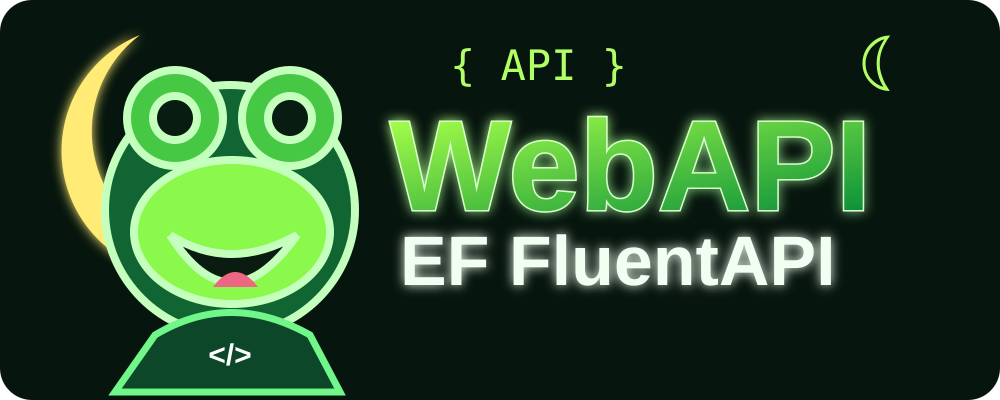

# 🐸 WebAPI EF FluentAPI

Dark-green ASP.NET Core 8 Web API starter with a smiling frog and crescent-moon identity. The same shared mascot asset is used in the header, hero, monitor wallboard and favicon.



## Stack

- C# / ASP.NET Core 8 minimal REST API
- EF Core InMemory for model demonstration and Fluent API `IEntityTypeConfiguration<T>` mappings
- JSON files for actual persistence, independently of EF Core (EF Core does **not** write the JSON files)
- Swagger/OpenAPI, dark-mode HTML/CSS/JavaScript dashboard

## Run

```bash
dotnet restore
dotnet run
```

Open the URL printed by dotnet and navigate to `/swagger` for API documentation.

## Endpoints

| Method | Route | Purpose |
|---|---|---|
| GET | /api/health | Health status |
| GET | /api/boards | List boards |
| GET | /api/boards/{id} | Read board |
| POST | /api/boards | Create board |
| PUT | /api/boards/{id} | Replace board |
| DELETE | /api/boards/{id} | Delete board |

**Note:** This is a starter demo, not a production authentication or transactional database solution. JSON storage is serialized under a process-local lock. The original generated PNG is not embedded in this commit; the site currently uses a lightweight SVG frog variant.